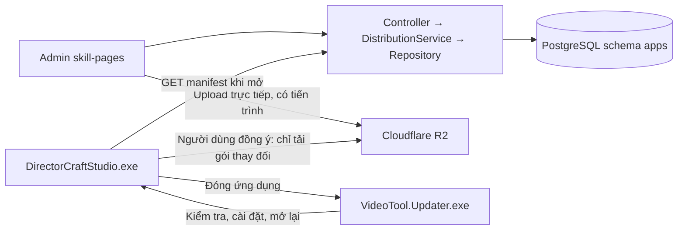

# Quản lý phát hành VideoTool qua skill-pages và Cloudflare R2

## Kiến trúc đã triển khai

Giữ nguyên modular monolith. Không thêm microservice, scheduler, agent nền hay database mới.



### Dữ liệu trong schema apps

| Bảng | Vai trò |
|---|---|
| `app_sources` | Một phiên bản file/gói: key, version, platform, URL R2, SHA256, byte size, ZIP/FILE, đường dẫn cài đặt tương đối, file kiểm tra, metadata riêng của admin. |
| `app_releases` | Bản phát hành: version, channel, platform, ghi chú, DRAFT/PUBLISHED/WITHDRAWN. |
| `app_release_items` | Ghim các source cụ thể vào release. |

Release version độc lập với phiên bản EXE. Ví dụ: release `1.0.2` vẫn ghim `app@1.0.0`, nhưng thay `opencode@2.0.29` bằng `opencode@2.0.30`. Máy đang dùng app 1.0.0 chỉ tải OpenCode nếu đã cài OpenCode.

Source được ghim trong bất kỳ release nào đều không sửa/xóa được. Muốn thay file, tạo source version mới với URL mới. Có thể xóa release nháp trước để bỏ ghim. Release đang phát hành chỉ được thu hồi, không sửa đè/xóa lịch sử. Máy khách không tự hạ phiên bản khi thu hồi.

`metadata.publisherSourcePath` có thể chứa đường dẫn như `E:\Sources\...` để admin tra cứu. Server deploy không thể đọc ổ E: của máy publisher. Phải upload file/gói lên R2 trước; API public không trả metadata riêng này.

### API và trang admin

- Admin: `/admin/app-releases` (có trong sidebar).
- API admin: `/api/admin/apps/:slug/distribution` và các nhánh `sources`, `sources/:id`, `releases`, `releases/:id`.
- Manifest: `GET /api/apps/video-tool/updates?channel=stable&platform=win-x64`.
- Hợp đồng: `{ "data": { "schemaVersion": 1, "appSlug": "video-tool", "releaseId": "...", "version": "1.0.1", "application": {...}, "resources": [...] } }`. Chưa phát hành: `{ "data": null }`.
- Manifest public chỉ chứa metadata tải bản phát hành. Phân quyền tính năng/subscription vẫn qua entitlement hiện có.
- HTTP, validation và phân quyền ở controller; nghiệp vụ ở application; Prisma/R2 ở infrastructure. Không join sang authentication/catalog/payment.

## Cấu hình môi trường

| Cách chạy | API mặc định |
|---|---|
| Debug | `http://localhost:3000` |
| Release/publish EXE | `https://www.onedaybetter.online` |

Dùng chung `AppEndpoints`, không hardcode URL khác trong updater. Cần chạy bản Release với API local: đặt `VIDEOTOOL_BASE_URL=http://localhost:3000` trong môi trường khởi chạy. Updater không gọi API và không giữ credential R2.

Server dùng cấu hình R2 sẵn có trong `.env.example`. Bucket CORS phải cho phép PUT từ origin web/local, expose `ETag` cho multipart. Upload app-source tối đa 20 GiB, part 64 MiB; URL upload part có hạn 6 giờ để đủ thời gian cho model lớn. Các loại upload cũ giữ giới hạn 2 GiB và hạn URL hiện có. Admin có thể nhập URL có sẵn thuộc R2 đã cấu hình, trong `app-sources/`, `tools/` hoặc `tool-files/`. Server HEAD object bằng S3 API để kiểm tra file tồn tại và dung lượng; client kiểm tra SHA256 khi tải.

## Phát hành từ GitHub (khuyến nghị)

GitHub là nơi giữ version: mỗi bản phát hành là một tag `vX.Y.Z` trên repo DirectorCraft.NativeAOT.
skill-pages **không build** và **không tự đặt số version**; nó chỉ nhận kết quả để phân phối cho updater.
Lý do vẫn cần skill-pages: manifest ghim cả app lẫn tài nguyên (model, FFmpeg…) trên R2, có DRAFT/PUBLISHED/WITHDRAWN,
và repo có thể để private mà khách vẫn tải được.

1. `git tag v1.2.0 && git push origin v1.2.0` (hoặc Actions → Release → Run workflow, nhập `1.2.0`).
2. `.github/workflows/release.yml` chạy test, `scripts/publish-customer-release.ps1 -Version 1.2.0`, tạo GitHub Release
   kèm `.zip`, `.zip.sha256`, `.zip.release.json`.
3. Nếu đã cấu hình R2 + skill-pages: upload zip vào `app-sources/video-tool/1.2.0/` rồi gọi
   `POST /api/ci/apps/video-tool/releases` (Bearer `RELEASE_CI_TOKEN`). Endpoint tạo source `app@1.2.0` và release
   `1.2.0` ghim source đó **cùng các tài nguyên của release đang phát hành**; chạy lại cùng version không tạo trùng,
   khác SHA256 thì từ chối.
4. Mặc định release ở trạng thái DRAFT: admin kiểm tra ở `/admin/app-releases` rồi bấm Phát hành. Chọn `publish` khi
   chạy tay để phát hành ngay.

Cấu hình: skill-pages đặt `RELEASE_CI_TOKEN` (≥ 32 ký tự). Repo GitHub đặt secret `SKILL_PAGES_RELEASE_TOKEN` (cùng giá trị),
`R2_ACCOUNT_ID`, `R2_ACCESS_KEY_ID`, `R2_SECRET_ACCESS_KEY` và variable `SKILL_PAGES_URL`, `R2_BUCKET_NAME`, `R2_PUBLIC_URL`.
Thiếu cấu hình thì workflow chỉ dừng ở GitHub Release; làm tiếp thủ công theo mục dưới.

Không sửa tay số version ở trang admin cho khớp GitHub: version của release lấy từ tag. Trang admin chỉ dùng để duyệt,
phát hành/thu hồi và thay tài nguyên.

## Phát hành thủ công (lần đầu hoặc khi không dùng CI)

1. Database local đã được áp dụng migration `20261016090000_app_distribution`. Khi deploy web, chạy `npm run db:deploy` trong môi trường database production rồi build/deploy bằng quy trình hiện có. Không dùng reset/db push cho production.
2. Build gói app từ thư mục VideoTool, PowerShell 7:

   ```powershell
   pwsh -File scripts/publish-customer-release.ps1 -Version 1.0.0
   ```

   Script publish NativeAOT cả hai EXE và tạo ZIP, `.sha256`, `.release.json` tại `artifacts/releases/`. Không kèm Binaries và PDB. Mỗi version/output mới phải có đường dẫn mới.
3. Mở `/admin/app-releases`, chọn `video-tool`. Tạo app trong `/admin/apps` nếu chưa có.
4. Nạp `.release.json`, upload ZIP, nạp `.sha256`, rồi lưu source. Cần giữ `key=app`, `format=ZIP`, `installDirectory` rỗng và `entryPoint=DirectorCraftStudio.exe` (updater vẫn nhận `VideoTool.exe` cho gói cũ). ZIP chứa đầy đủ DLL, scripts và `VideoTool.Updater.exe` ở gốc.
5. Đóng gói tài nguyên bằng `scripts/package-cloudflare-resource.ps1`, nạp metadata/upload tương tự. Xem `CLOUDFLARE_RESOURCE_CATALOG.md` để biết file hiện có, thư viện còn thiếu và bố cục ZIP.
6. Chọn một gói ứng dụng và một phiên bản mỗi tài nguyên, tạo nháp, kiểm tra danh sách rồi bấm Phát hành. Chỉ release PUBLISHED mới xuất hiện trong manifest; chọn số version lớn nhất theo x.y.z trong đúng channel/platform.

**Máy đang chạy bản cũ chưa có updater cần tải gói app mới một lần.** Những bản đã có updater sẽ cập nhật trong ứng dụng về sau. Không có cách bổ sung code updater vào EXE cũ chưa hỗ trợ mà không nâng bản đó trước.

## Cập nhật sau này

### Chỉ thay tài nguyên

Tạo source version mới cho tài nguyên đó. Tạo release version mới nhưng chọn lại source `app` hiện tại và giữ các source tài nguyên khác. Không cần rebuild EXE. Không upload lại các gói không đổi.

### Thay ứng dụng

Publish với `-Version` mới, upload ZIP và tạo source app mới. Release mới ghim source app đó và dùng lại source tài nguyên cũ.

### Thêm thành phần mới

Tạo key duy nhất, đường dẫn tương đối trong Binaries và version x.y.z. Manifest có thể bổ sung gói vào trang tài nguyên mà không sửa URL trong EXE. Tính năng thực sự sử dụng thành phần mới vẫn cần code tương ứng trong app. Đường dẫn của thành phần đã được code dùng không được đổi tùy tiện qua admin; client từ chối release làm đổi hợp đồng đó.

### Xóa/thu hồi

Admin xóa cấu hình source chưa ghim và xóa release nháp; thu hồi release đã phát hành. **Không tự xóa object R2** khi xóa cấu hình: URL cũ có thể đang được máy khách sử dụng. Dọn object orphan trong R2 theo thời hạn lưu trữ do publisher chọn; không xóa file còn được release/nguồn tải cũ tham chiếu. Đây là chính sách giữ bản phát hành, không phải xóa file trên máy khách.

## Luồng khách hàng

1. Khi mở, app kiểm tra API ở nền, có timeout; mạng lỗi không chặn công việc.
2. Có thay đổi: banner thông báo, Xem cập nhật hoặc Để sau. Cài đặt có nút Kiểm tra cập nhật.
3. Dialog liệt kê đúng thành phần và dung lượng; tải có byte/%/giai đoạn, hủy và thử lại. Gói tải xong có thể để sau và dùng lại khi kiểm tra lại cùng release, không tải lại gói đó.
4. Chỉ cập nhật tài nguyên đã cài trong cache do app quản lý. Tài nguyên tùy chọn chưa cài tải khi dùng tính năng. Tool từ PATH hoặc Binaries đóng kèm do publisher quản lý không bị ghi đè.
5. File tải tạm và SHA256/size được kiểm tra trước. Người dùng lưu công việc rồi chọn khởi động lại.
6. Updater chạy từ staging riêng, có cửa sổ trạng thái, chờ app đóng, kiểm tra lại gói, chống ZIP traversal/symlink, kiểm tra file bắt buộc, cài đặt và mở lại app. Nếu thay file gặp lỗi, thử khôi phục các backup đã tạo. Backup không bị xóa nếu rollback lỗi; log có suffix/đường dẫn để phục hồi.
7. App và updater dùng chung khóa cài đặt; chỉ một phiên desktop chạy tại một thời điểm để tránh DLL bị giữ khi cập nhật. Chế độ MCP độc lập giữ hành vi hiện có.

### Dữ liệu trên máy khách

| Vị trí | Nội dung |
|---|---|
| Thư mục app | EXE, updater, DLL và scripts. Phải cho phép tài khoản người dùng ghi; nên dùng thư mục portable thuộc tài khoản. |
| `%LocalAppData%\VideoTool\Binaries` | Cache công cụ và model; giữ qua các lần cập nhật EXE. |
| `%LocalAppData%\VideoTool\installed-resources.json` | Version và SHA256 của các tài nguyên đã cài. |
| `%LocalAppData%\VideoTool\manifest-*.json` | Catalog cache tách theo API môi trường, dùng khi offline. |
| `%LocalAppData%\VideoTool\Updates\<job>` | Gói tải, updater staging, job và kết quả/log. |

FFmpeg/FFprobe cũ chưa có receipt được so hash để nhận diện gói không đổi, tránh tải lại cùng file. Archive cũ không có receipt không đủ dữ liệu để biết checksum ZIP gốc; có thể cần tải lại một lần khi đưa vào quản lý version.

## Giới hạn cần biết

- Client Windows x64/stable, protocol 1. Admin có beta để chuẩn bị bản nháp/thử nghiệm nhưng client hiện tại không tự đăng ký beta.
- Bảo vệ bằng TLS, quyền admin, SHA256, size, staging và rollback khi lỗi thao tác file. Không có ký manifest độc lập hay chữ ký Authenticode được tạo tự động.
- Rollback xử lý lỗi trong tiến trình cài đặt; chưa có journal phục hồi tự động cho trường hợp mất điện/kill process giữa lúc thay file. Giữ backup/log để xử lý tình huống đó.
- Không tự nâng quyền để ghi Program Files, không cài service Windows, không chạy shell/pip/npm installer từ manifest.
- Không tự upload hoặc phát hành bản production. R2 cần đủ gói đã mô tả trong catalog, và web production cần deploy migration/code trước khi khách hàng nhận được manifest.

## Trạng thái thực thi

- Schema/API/admin đã thêm vào `E:\Sources\Webs\SupperMoney\skill-pages`.
- Migration đã áp dụng vào PostgreSQL `localhost:5432`, database `skill-pages`.
- Biên dịch solution .NET và TypeScript thành công trong phiên triển khai; kết quả đóng gói cuối được ghi tại phần bàn giao.
- Next.js production build và ESLint cho các file thay đổi đã thành công. NativeAOT publish cuối của cả app và updater thành công, không cảnh báo.
- Gói bàn giao: `artifacts/customer-release-updater-20261016/VideoTool-1.0.0-win-x64.zip`, 27,202,930 byte. SHA256: `1159a4df2c485ef264e7d2770e95ca00c70bc315155963562406b482f3616879`. Hai file `.zip.sha256` và `.zip.release.json` ở cùng thư mục; metadata có thể nạp trực tiếp tại trang admin rồi upload ZIP/nạp SHA.
- Không chạy bộ test hay giả lập nâng cấp trên máy khách trong lượt này; cần kiểm tra quy trình phát hành với gói R2 thật trước khi mở cho khách hàng.
